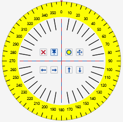
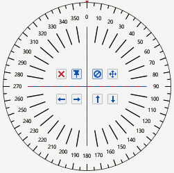

# Win桌面罗盘

Windows 桌面悬浮罗盘，采用 WPF 矢量绘制，不依赖表盘位图或外置字体文件。

现已增加天线覆盖面板：按天线工参计算近点、中点、远点，或通过目标距离反算下倾角；支持会员版奥维地图取点、两点拉线及直接绘制覆盖扇形。

## 使用天线覆盖

在罗盘上按 **F2**，或右键选择 **天线覆盖…**。也可独立打开覆盖面板：

```powershell
& '.\Compass x64_x86.exe' --coverage
```

1. 输入站点经纬度，选择输入坐标类型。也可以连接奥维后，点击 **地图选站点** 并在地图上单击站点位置。
2. 选择 **按工参计算**，输入水平/垂直波束宽度、天线中心挂高、接收点高度、地面海拔及机械/电下倾角。右侧立即显示近、中、远距离与预览。
3. 需要按目标反算时，选择 **按目标距离反算总下倾角**，选择终点绑定远点或中点，输入目标距离和方位角。
4. 也可输入终点经纬度后点击 **应用终点坐标**，或使用 **地图拉线：起点 → 终点**，依次在奥维单击起点、终点。软件计算两点的水平距离与真北方位角。
5. 调整 **蓝色填充透明度**，点击 **生成 / 更新到奥维**。近、中、远弧线和两侧边界为红色；默认填充整个扇形，也可勾选 **仅填充近点至远点**。

本地预览支持点击或按住拖动调整方向与目标距离。工参模式下，目标距离是参考值；反算模式下，它约束所选的中点或远点。反算会单独显示“目标所需总下倾角”，保留当前机械、电下倾角。

### 连接会员版奥维

1. 在奥维 Windows 客户端启用第三方 WebSocket 服务，设置端口及预共享密钥，并确认账户具备接口所需会员权限。
2. 在覆盖面板输入实际服务地址，例如 `ws://127.0.0.1:7699`，以及对应密钥，然后点击 **连接奥维**。地址和端口以奥维设置为准；也支持 `wss://`。
3. 使用地图取点、定位及生成按钮。勾选 **参数变化时更新奥维** 后，参数或样式变化会更新本次扇形。

图形通过官方接口直接创建为奥维临时对象，使用地理坐标随地图缩放和平移，无需导入图层文件或手动标定比例尺。**清除本次扇形**仅删除本次连接中软件已确认创建的对象，不清空奥维其他临时对象。

地图拉线当前采用两次单击；地图内按住拖动、移动中连续预览尚未接入。取点应在 120 秒内完成；**取消取点**或超时会关闭当前连接，重新连接后可继续。临时地图对象由奥维管理，断开连接后可能仍显示在奥维中；需要清除时，请在断开前使用清除按钮。

界面会显示会员权限、密钥错误、连接断开或协议错误。会员接口已通过本地模拟服务验证；真实奥维的取点交互、图形样式及版本兼容性仍需在会员机联调。本机无会员时可使用计算、预览、经纬度输入及参数保存。

### 参数与公式

角度统一使用度，距离与高度使用米。输入波束宽度使用厂家给出的完整 −3 dB 水平/垂直波束宽度，非半角。目标地面采用水平面，高程与接收点高度可手动输入。

| 参数 | 符号 | 含义 |
| --- | --- | --- |
| 天线挂高 | ha | 天线中心相对站址地面的高度；楼顶站应计入楼高 |
| 接收点高度 | hr | 相对目标地面的高度，默认 0 |
| 站址/目标地面海拔 | zs、zt | 使用相同高程基准，默认等高 |
| 水平/垂直波束宽度 | Bh、Bv | 完整夹角 |
| 机械/电下倾角 | θm、θe | 向下为正 |
| 方位角 | A | 真北 0°，东 90°，顺时针增加 |

```text
有效高度差 H = (zs + ha) - (zt + hr)
主轴近似总下倾角 θ = θm + θe
近点水平距离 = H / tan(θ + Bv/2)
中点水平距离 = H / tan(θ)
远点水平距离 = H / tan(θ - Bv/2)

目标距离反算：γ = atan(H / 目标距离)
终点绑定远点：所需总下倾角 = γ + Bv/2
终点绑定中点：所需总下倾角 = γ
扇形方向范围：[A - Bh/2, A + Bh/2]
```

代码在计算前将角度转换为弧度。中点为主瓣中心线落点，并非近、远距离的算术平均值。

默认示例为挂高 30 m、总下倾 6°、水平波束 65°、垂直波束 8°、方位 120°：近点 **170.14 m**，中点 **285.43 m**，远点 **859.09 m**。

边界处理与精度：

- 高度差必须大于零；主瓣下边缘超过垂直向下方向或整个主瓣高于目标平面时提示参数问题。
- 射线平行或高于目标平面时显示 **无有限落点**；超出最大显示距离时单独绘制 **显示截断** 虚线，不把截断距离标成实际远点。
- 最大显示距离可设为 1～100000 m。该上限仅限制显示，不能提高平坦地面模型在远距离下的精度。
- 地理坐标采用 WGS84 椭球上的 Vincenty 正反算；近对跖点不收敛时明确提示。方位跨越 0°时正常绘制。
- WGS84 / CGCS2000 在此按工程近似处理，不包含测量级历元、基准转换。GCJ-02 输入及地图拾取转换后参与计算；奥维返回当前工程坐标时提示切换经纬度坐标。
- 三条圆弧是把主轴距离扩展到整个水平张角的近似示意。本功能未读取地形，也未进行功率、传播损耗、建筑或植被的信号覆盖预测。

### 保存参数

关闭覆盖面板时，将最后有效的参数及连接地址保存到 `%LOCALAPPDATA%\Compass\coverage.xml`，下次打开恢复。也可通过 **保存参数… / 读取参数…** 交换 XML 配置。预共享密钥不会写入配置，自动更新奥维的开关也不会在下次启动时自动开启。

连接现有罗盘时，初始方向沿用罗盘当前方位，之后双向联动；独立启动使用上次保存的参数。GCJ-02 转换采用 BSD 许可代码，许可文本已嵌入 EXE，可在天线覆盖窗口点击 **第三方许可** 查看，也可阅读仓库中的 [ThirdPartyNotices.txt](ThirdPartyNotices.txt)。

### 开发验证

```powershell
.\tests\run-tests.ps1
.\tests\run-tests.ps1 -UI
```

测试覆盖几何计算、目标反算、地平线及输入边界、WGS84 正反算、GCJ-02 转换、配置读写，以及基于本地 WebSocket 模拟服务的认证、取点、定位、图形更新、定向删除、取消和超时。`-UI` 额外验证 WPF 操作流程并生成预览截图；这些检查不替代会员机实测。

协议参考：[奥维官方开发接口](https://www.ovital.com/openapi/)、[WebSocket 协议说明](https://www.gpsov.com/appdoc/index.php?id=32)。

- 版本：1.1（程序集版本 1.1.0.0）
- 作者：LmTec
- 公司：流氓工作室
- 运行环境：x86 或 x64 Windows，安装 .NET Framework 4.8。建议使用 Windows 10/11。

## 程序预览

以下为旧版程序在中性灰画布（`#AEB4BC`）上的窗口截图，用于说明黄色表盘和透明表盘两种模式。灰色仅为截图背景；截图未缩放，不代表新版的尺寸或样式。

### 黄色表盘



### 透明表盘



## 运行与分发

直接运行 `Compass x64_x86.exe`。程序默认置顶、无边框，并显示任务栏按钮。

分发时只需提供 `Compass x64_x86.exe`。图标和 DPI 清单已嵌入程序，无需随附源码、`icon.ico` 或 `app.manifest`。

程序采用 AnyCPU 编译：同一个 EXE 在 32 位 Windows 上以 x86 运行，在 64 位 Windows 上以 x64 运行，无需区分下载版本。

## 操作

- 在转盘圆面内按住鼠标左键拖动，旋转刻度盘；数字和方向字母随盘移动，字形保持水平。
- 圆面内透明区域也拦截鼠标点击，不会穿透到下方窗口；按钮优先执行各自功能。
- 鼠标悬停在中间按钮上可查看文字提示。

按钮按屏幕从左到右排列：

| 位置 | 按钮功能 |
| --- | --- |
| 上排 | 关闭、置顶开关、圆环底色开关、拖动窗口 |
| 下排 | 左移、右移、上移、下移 |

四向移动按钮每次移动 **1 DIP（逻辑像素）**，不是调整方位角。

窗口获得键盘焦点后：

| 按键 | 功能 |
| --- | --- |
| 左 / 右方向键 | 方位角减 / 加 1 度 |
| Shift + 左 / 右方向键 | 方位角减 / 加 10 度 |
| Home | 方位角归零 |
| Esc | 关闭程序 |

## 显示与 DPI

- 窗口尺寸为 344 × 344 DIP，随显示器 DPI 缩放。
- 圆环底色为浅黄色，可切换为透明；中心始终透明。透明模式下，主要刻度和文字带有对比描边，方便在不同底图上读数。
- 指针和红蓝等长相间的十字线固定，十字线限制在内圈内。
- 刻度按 1°、5°、10°、30°、90° 区分长短和粗细；数字和方向字母使用 Segoe UI 半粗体。
- 圆环、刻度和按钮图标均使用 WPF 矢量绘制，不依赖表盘位图。曲线、斜线和文字使用抗锯齿渲染，文字起点及部分横竖线对齐物理像素。

## 与 Protractor.exe 的差异

本程序参考了 `Protractor.exe` 的表盘视觉风格，但并非原程序的逐像素复刻。以下比较限于表盘显示与绘制实现，不涉及按钮及外置组件功能。

| 对比项 | Protractor.exe 参考表盘 | 本程序 |
| --- | --- | --- |
| 绘制方式 | 使用内嵌的预制表盘图片，已核对 GIF 资源尺寸为 251 × 249 像素 | WPF 直接绘制几何图形和字形轮廓，不加载表盘位图 |
| 小数字 | 字形固定在图片中，顶部样本数字约为 3 × 5 像素，原尺寸下是硬像素笔画 | 使用随显示器 DPI 绘制的 Segoe UI 半粗体 |
| 数字方向 | 参考图片初始状态的数字基本水平；图片本身固定了各数字方向 | 数字位置随转盘移动，字形始终保持水平 |
| 正方向标识 | 参考图片以 0、90、180、270 标注四个正方向 | 对应位置不绘制数值标签，另以 N、E、S、W 标明方向 |
| 内圈线条 | 参考图片中有伸入内圈的黑色径向长线 | 不绘制这些内圈径向长线，保留固定指针和红蓝十字线 |
| 十字线 | 红蓝交替样式预制在参考图片中 | 红蓝线段等长、独立绘制，范围限制在内圈内 |
| 边缘处理 | 参考图片放大后可见圆周、斜线等位置的阶梯状像素边缘 | 圆周、斜线和文字使用抗锯齿渲染，部分横竖线按物理像素对齐 |
| DPI 适配 | 预制图片的字形细节固定；其缩放效果取决于原程序和系统的显示处理 | 声明 Per-Monitor DPI 感知，按显示器 DPI 绘制表盘和文字 |

上述参考侧结论来自已核对的表盘资源，不代表对原程序全部运行行为或性能的测试。

## 构建

构建支持 x86 和 x64 Windows，需要 .NET Framework 4.8 及 PowerShell。脚本使用系统自带的 .NET Framework C# 编译器并输出 AnyCPU 程序，无需安装 Visual Studio 或下载 NuGet 包。

先关闭正在运行的 `Compass x64_x86.exe`，然后在项目目录执行：

```powershell
.\build.ps1
```

默认输出到当前项目目录。也可以指定输出目录：

```powershell
.\build.ps1 -OutputDirectory .\dist
```

若 PowerShell 执行策略阻止运行脚本，可仅对本次进程指定执行策略：

```powershell
powershell.exe -NoProfile -ExecutionPolicy Bypass -File .\build.ps1
```

构建成功后会输出 EXE 的 SHA256。

## GitHub 自动编译

项目包含 `.github/workflows/build.yml`。提交并推送到 GitHub 后，每次推送都会在 Windows runner 上执行 `build.ps1`，生成支持 x86/x64 的 AnyCPU 程序。

也可在仓库的 **Actions → Build Compass → Run workflow** 手动触发。编译完成后，在对应运行页面的 **Artifacts** 中下载 `Compass-x64-x86`，解压得到 `Compass x64_x86.exe`。

普通分支推送只编译并上传构建附件；推送 `v*` 版本标签时，会在编译成功后自动创建 GitHub Release，并附上 EXE。程序文件无需提交进 Git 仓库。

例如发布当前版本：

```powershell
git tag v1.1
git push origin v1.1
```

后续发布使用新的版本标签，并先更新源码中的版本信息；不要覆盖已发布的标签。Release 页面可直接下载 EXE，不必解压 Actions 构建附件。

只有标签发布任务申请 `contents: write` 权限，普通编译任务保持只读权限。如果仓库禁用了 Actions，需要先在 **Settings → Actions → General** 中启用。

## 文件说明

| 文件 | 用途 |
| --- | --- |
| `CompassVector.cs` | 程序入口、窗口、矢量绘制和交互逻辑 |
| `build.ps1` | 编译并嵌入图标和应用清单 |
| `icon.ico` | 构建时使用的程序图标 |
| `app.manifest` | 高 DPI 感知和普通权限运行声明，构建时嵌入 EXE |
| `Compass x64_x86.exe` | 可直接运行和分发的最终程序 |

Git 和开发工具配置不属于运行依赖。`app.manifest` 需要保留在源码目录供重新编译使用，但不是运行时的外置依赖。
